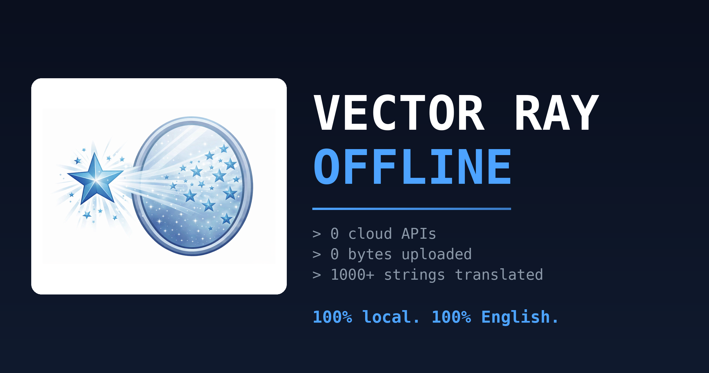
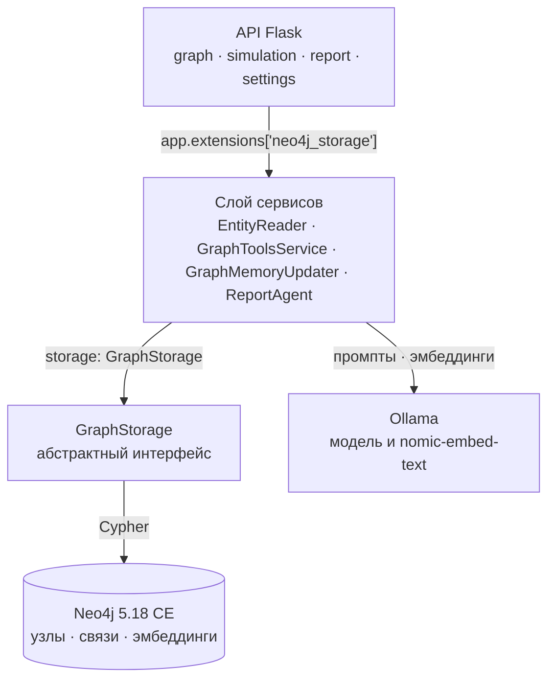

<div align="center">



# Vector Ray-Offline

**Полностью локальный форк [MiroFish](https://github.com/666ghj/MiroFish) — без облачных API. Русский интерфейс.**

*Движок мультиагентной симуляции: общественное мнение, настроения рынка и социальная динамика — целиком на вашем железе.*

[](https://github.com/Osmosy/vector-ray/stargazers)
[](https://github.com/Osmosy/vector-ray/network)
[](./LICENSE)

</div>

## Что это

Vector Ray — движок мультиагентной симуляции. Загружаете документ — пресс-релиз, законопроект, финансовый отчёт — и получаете сотни ИИ-агентов с собственными характерами, которые воспроизводят реакцию аудитории в имитации соцсети: посты, споры, сдвиги мнений, час за часом.

[Оригинальный MiroFish](https://github.com/666ghj/MiroFish) делался под китайский рынок: китайский интерфейс, Zep Cloud для графа знаний, DashScope для моделей. Этот форк переводит всё на локальный контур и на русский язык:

| Оригинальный MiroFish | Vector Ray-Offline |
|---|---|
| Китайский интерфейс | **Русский интерфейс** (переведены интерфейс и промпты моделей) |
| Zep Cloud (память графа) | **Neo4j Community Edition 5.18** |
| DashScope / OpenAI API (модели) | **Ollama** (qwen2.5, llama3 и другие локальные модели) |
| Эмбеддинги Zep Cloud | **nomic-embed-text** через Ollama |
| Нужны облачные ключи | **Ни одной облачной зависимости** |

## Как это работает

1. **Граф** — из документа извлекаются сущности (люди, компании, события) и связи между ними. Строится граф знаний с памятью отдельных участников и групп в Neo4j.
2. **Окружение** — генерируются сотни персонажей: характер, склонность к риску, скорость реакции, уровень влияния, память о прошлых событиях.
3. **Симуляция** — агенты общаются на имитированных площадках: постят, отвечают, спорят, меняют мнение. Система в реальном времени отслеживает динамику настроений, распространение тем и влияние участников.
4. **Отчёт** — агент отчёта разбирает состояние после симуляции, проводит интервью с фокус-группой, ищет доказательства в графе знаний и собирает структурированный анализ.
5. **Взаимодействие** — чат с любым агентом симуляции: спросите, почему он написал именно это. Память и характер сохраняются.

## Документация

- **[Руководство пользователя](docs/USER_GUIDE.md)** — установка в Docker и без него, настройка `.env`, работа по шагам, где лежат данные, разбор типичных ошибок.
- **[Архитектура и диаграммы](docs/ARCHITECTURE.md)** — слои системы, путь одного прогона, решения форка.
- **[Живая схема архитектуры](https://osmosy.github.io/vector-ray/vector-ray.architecture.html)** — интерактивная схема: темы, три сценария просмотра, поиск по узлам, трассировка связей, экспорт.

## Быстрый старт

### Что нужно

- Docker и Docker Compose (рекомендуется), **либо**
- Python 3.11+, Node.js 18+, Neo4j 5.18+, Ollama

### Вариант А: Docker (проще всего)

```bash
git clone https://github.com/Osmosy/vector-ray.git
cd vector-ray
cp .env.example .env

# Ollama остаётся на хосте — compose поднимает только Neo4j и приложение
ollama pull qwen2.5:14b
ollama pull nomic-embed-text

# Внутри контейнера localhost — это сам контейнер, поэтому адреса моделей
# указывают на хост, а пароль Neo4j совпадает с тем, что задаёт compose
sed -i 's|http://localhost:11434|http://host.docker.internal:11434|g' .env
sed -i 's|^NEO4J_URI=.*|NEO4J_URI=bolt://neo4j:7687|' .env
sed -i 's|^NEO4J_PASSWORD=.*|NEO4J_PASSWORD=vectorray123|' .env

docker compose up -d
docker compose ps      # оба контейнера Up (healthy)
```

Открыть `http://localhost:3000`. Neo4j Browser — на `http://localhost:7474`.

### Вариант Б: вручную

**1. Neo4j**

```bash
docker run -d --name neo4j \
  -p 7474:7474 -p 7687:7687 \
  -e NEO4J_AUTH=neo4j/vectorray123 \
  neo4j:5.18-community
```

**2. Ollama и модели**

```bash
ollama serve &
ollama pull qwen2.5:32b      # модель для рассуждений (или qwen2.5:14b, если мало видеопамяти)
ollama pull nomic-embed-text  # эмбеддинги, 768 измерений
```

**3. Бэкенд**

```bash
cp .env.example .env
# поправьте .env, если Neo4j или Ollama живут на других портах

cd backend
pip install -r requirements.txt   # либо: uv sync
python run.py                     # либо: uv run python run.py
```

**4. Фронтенд**

```bash
cd frontend
npm install
npm run dev
```

Открыть `http://localhost:3000`. Одной командой из корня: `npm run setup:all && npm run dev`.

## Настройка

Все параметры — в `.env` (копия `.env.example`):

```bash
# Модели — локальная Ollama (API, совместимый с OpenAI)
LLM_API_KEY=ollama
LLM_BASE_URL=http://localhost:11434/v1
LLM_MODEL_NAME=qwen2.5:32b

# Neo4j
NEO4J_URI=bolt://localhost:7687
NEO4J_USER=neo4j
NEO4J_PASSWORD=vectorray123

# Эмбеддинги
EMBEDDING_MODEL=nomic-embed-text
EMBEDDING_BASE_URL=http://localhost:11434
```

Подойдёт любой провайдер с OpenAI-совместимым API: замените Ollama на облачную модель, поменяв только `LLM_BASE_URL` и `LLM_API_KEY`. Полный список переменных — в [руководстве пользователя](docs/USER_GUIDE.md#4-настройка-env).

## Архитектура

Форк добавляет чистый слой абстракции между приложением и графовой базой:



**Ключевые решения:**

- `GraphStorage` — абстрактный интерфейс: замена Neo4j на другую графовую СУБД это один новый класс.
- Внедрение зависимостей через `app.extensions` во Flask, без глобальных синглтонов.
- Гибридный поиск: 0.7 × косинусная близость вектора + 0.3 × BM25 по ключевым словам.
- Синхронное извлечение сущностей и связей локальной моделью вместо асинхронных «эпизодов» Zep.
- Все исходные структуры данных и инструменты агента отчёта (InsightForge, Panorama, интервью с агентами) сохранены.

## Требования к железу

| Компонент | Минимум | Рекомендуется |
|---|---|---|
| ОЗУ | 16 ГБ | 32 ГБ |
| Видеопамять | 10 ГБ (модель 14b) | 24 ГБ (модель 32b) |
| Диск | 20 ГБ | 50 ГБ |
| Процессор | 4 ядра | 8+ ядер |

Без GPU всё работает, но рассуждения модели заметно медленнее. Для слабых машин берите `qwen2.5:14b` или `qwen2.5:7b`.

## Где пригодится

- **Проверка PR-рисков** — проиграть реакцию аудитории на пресс-релиз до публикации.
- **Сигналы для рынка** — прогнать финансовые новости и посмотреть на смоделированные настроения.
- **Анализ регулирования** — проверить черновик нормативного акта на смоделированной реакции.
- **Творческие эксперименты** — кто-то скормил системе классический роман с утраченной концовкой, и агенты дописали связное завершение.

## Лицензия

AGPL-3.0 — как и у оригинального MiroFish. См. [LICENSE](./LICENSE).

## Авторы и происхождение

Это изменённый форк [MiroFish](https://github.com/666ghj/MiroFish) авторства [666ghj](https://github.com/666ghj), который изначально поддерживался [Shanda Group](https://www.shanda.com/). Движок симуляции — [OASIS](https://github.com/camel-ai/oasis) команды CAMEL-AI.

**Что изменено в этом форке:**

- Бэкенд переведён с Zep Cloud на локальные Neo4j CE 5.18 и Ollama.
- Интерфейс и промпты моделей переведены с китайского на русский; агент отчёта пишет по-русски.
- Все упоминания Zep в интерфейсе заменены на Neo4j.
- Проект переименован в Vector Ray Offline.
