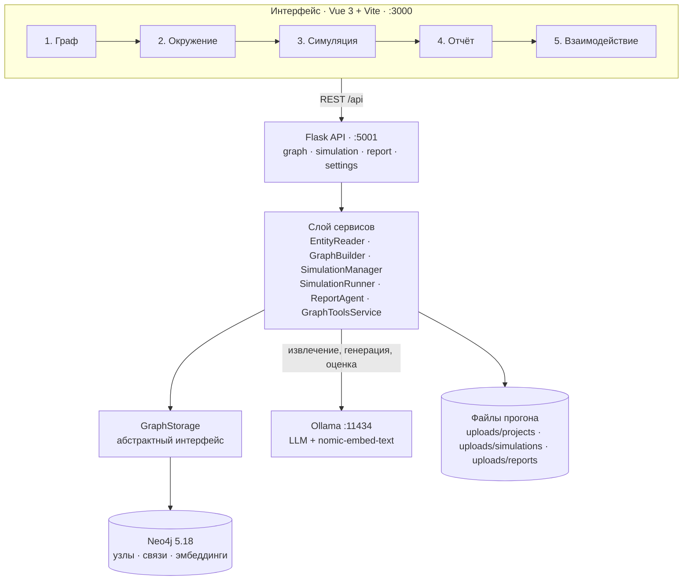
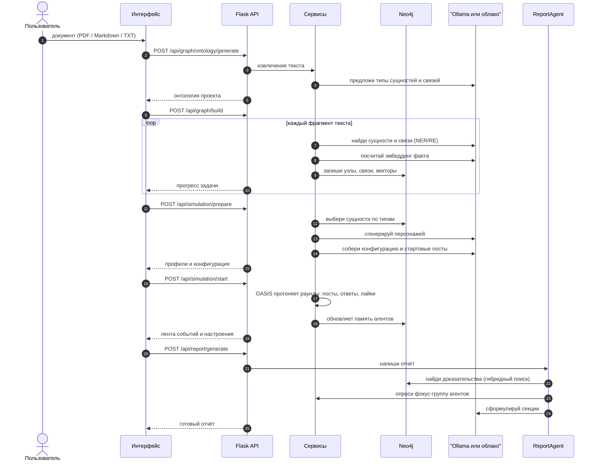
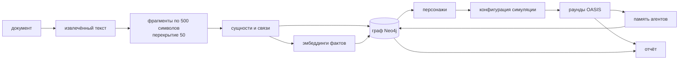

# Архитектура Vector Ray-Offline

Документ описывает, как устроен движок: из каких слоёв состоит, что происходит при одном прогоне и какие решения приняты в форке относительно оригинального MiroFish.

---

## 1. Компоненты



Смысл разделения: интерфейс ничего не знает о базе, API не знает о промптах, а слой сервисов не знает, какая именно графовая СУБД под ним — он работает с `GraphStorage`, реализация которого сегодня одна (`Neo4jStorage`).

---

## 2. Путь одного прогона



Два места, где прогон обычно стоит дороже всего: цикл построения графа (модель вызывается на каждый фрагмент) и раунды симуляции (модель вызывается на каждого активного агента в каждом раунде). Генерация персонажей и отчёта — разовые вызовы на шаг.

---

## 3. Слои и модули

| Слой | Каталог | За что отвечает |
|---|---|---|
| Интерфейс | `frontend/src/` | пять шагов, лента событий, редактор типов, чат с агентами |
| HTTP API | `backend/app/api/` | `graph.py` — онтология и построение графа; `simulation.py` — подготовка, запуск, интервью, статистика; `report.py` — генерация, секции, чат; `settings.py` — чтение и запись `.env` из интерфейса |
| Сервисы | `backend/app/services/` | `entity_reader` — выборка сущностей; `graph_builder` — сборка графа; `simulation_manager` — персонажи и конфигурация; `simulation_runner` — процесс симуляции и его состояние; `report_agent` — отчёт; `graph_tools` — поиск и интервью для агента отчёта; `graph_memory_updater` — запись действий агентов обратно в граф |
| Хранилище графа | `backend/app/storage/` | `graph_storage` (интерфейс), `neo4j_storage`, `embedding_service`, `search_service`, `ner_extractor`, `file_parser` |
| Конфигурация | `backend/app/config.py`, `.env` | адреса LLM и Neo4j, лимиты, параметры симуляции и отчёта |
| Файлы прогона | `backend/uploads/` | документы, состояние симуляций, отчёты и логи |

Группы эндпоинтов: `/api/graph/*` — загрузка, онтология, построение, статистика; `/api/simulation/*` — создание, подготовка, запуск, остановка, статусы, действия и интервью; `/api/report/*` — генерация, прогресс, секции, чат, скачивание; `/api/settings/*` — настройки и пресеты.

---

## 4. Решения, отличающие форк

1. **Абстракция хранилища.** Вместо облачного Zep — интерфейс `GraphStorage` и реализация `Neo4jStorage`. Замена графовой СУБД — это один новый класс, а не правка сервисов.
2. **Внедрение через `app.extensions`.** Хранилище лежит в расширениях Flask, глобальных синглтонов нет: тесты поднимают приложение с подменённым хранилищем.
3. **Гибридный поиск.** Релевантность считается как `0.7 × косинусная близость вектора + 0.3 × BM25 по ключевым словам`, поэтому находятся и точные формулировки, и смысловые совпадения.
4. **Синхронное извлечение NER/RE.** Вместо асинхронных «эпизодов» Zep фрагмент текста обрабатывается локальной моделью сразу и записывается в граф; отсюда и честный прогресс построения.
5. **Состояние прогона в файле.** `state.json` каждой симуляции — источник правды для интерфейса: по нему работают realtime-эндпоинты, он же переживает перезапуск бэкенда.
6. **Язык.** Интерфейс, промпты и сообщения об ошибках — на русском; отчёт пишется по-русски независимо от языка исходного документа.
7. **Модель — за OpenAI-совместимым интерфейсом.** Все обращения идут через `LLMClient` (`backend/app/utils/llm_client.py`) к `LLM_BASE_URL`, поэтому Ollama и облачный провайдер взаимозаменяемы без правок кода: локальный прогон упирается в видеокарту, облачный снимает эту нагрузку. Резервная цепочка (`MODEL_CASCADE`) состоит из локальных имён Ollama и на внешнем эндпоинте не срабатывает — ошибка провайдера возвращается как есть.
8. **Эмбеддинги остаются локальными.** `EmbeddingService` ходит в Ollama по `/api/embed` (768 измерений) независимо от того, где считается язык. Это осознанная привязка: размерность векторов зашита в схему Neo4j, и смена модели эмбеддингов сделала бы старые графы несопоставимыми с новыми.

---

## 5. Что происходит с данными



Круговой элемент здесь важен: действия агентов в симуляции возвращаются в граф как воспоминания, поэтому отчёт и чат на пятом шаге опираются не только на исходный документ, но и на то, что агенты успели «пережить».

---

## 6. Эксплуатация

| Вопрос | Ответ |
|---|---|
| Какие порты заняты | 3000 — интерфейс, 5001 — API, 7474/7687 — Neo4j |
| Где состояние | `backend/uploads/**` + том Neo4j (`neo4j_data`) |
| Можно ли разнести по машинам | да: адреса Ollama и Neo4j задаются в `.env`, интерфейс проксирует `/api` на API |
| Можно ли считать модель в облаке | да: `LLM_BASE_URL` / `LLM_API_KEY` / `LLM_MODEL_NAME` указывают на любого OpenAI-совместимого провайдера; эмбеддинги при этом остаются на локальной Ollama |
| Как посмотреть, что делает бэкенд | `docker compose logs -f vector-ray-offline`, лог отчёта — в каталоге отчёта |
| Какой режим запуска в Docker | `npm run dev` внутри контейнера: Vite на 3000 и Flask на 5001; для продакшена нужен свой образ со собранным фронтендом |

---

## 7. Живая схема

`docs/vector-ray.architecture.html` — интерактивная схема той же системы: светлая тема по умолчанию, переключение на тёмную, три сценария просмотра («Путь одного прогона», «Где работает модель», «Зачем GraphStorage»), поиск по узлам, трассировка связей, режим презентации и экспорт в SVG/PNG.

Она собрана генератором archify из спецификации `docs/vector-ray.architecture.json` — исходник в git, поэтому схему можно править как данные, а не как разметку:

```bash
node ~/.hermes/skills/archify/bin/archify.mjs validate architecture docs/vector-ray.architecture.json --quality showcase
node ~/.hermes/skills/archify/bin/archify.mjs deliver  architecture docs/vector-ray.architecture.json docs/vector-ray.architecture.html --quality showcase
```

Публикация — GitHub Pages из каталога `docs`: <https://osmosy.github.io/vector-ray/vector-ray.architecture.html>. Локально достаточно `python3 -m http.server 8000 --directory docs` и открыть <http://localhost:8000/vector-ray.architecture.html>.

Статические Mermaid-схемы выше остаются для чтения в самом Markdown и для диффов: артифакт archify — для показа, Mermaid — для правок текстом.

## 8. Ссылки

- [Руководство пользователя](USER_GUIDE.md) — установка, настройка, работа по шагам, разбор ошибок.
- [README](../README.md) — краткая сводка проекта.
- [Статус адаптации](../ADAPTATION_STATUS.md) — что сделано, что в работе.
